# WoundSense: a smart wound-care bandage

A prototype that combines a low-cost sensing bandage, a phone app and a small server to
watch the conditions around a wound, estimate how it is doing, and answer questions using
real wound-care literature.

An **ESP32** on the bandage measures temperature, humidity and moisture. A **smartwatch**
worn near the wound adds heart rate and blood pressure. A **Tauri phone app** shows everything
live with history charts, runs a **wound-photo scan**, and has an **AI chat** that cites
published studies. A **Flask server** runs the models and the retrieval pipeline.

> **This is a student prototype, not a medical device.** It has not been tested on patients and
> must not be used to make treatment decisions. See [Honest scope](#honest-scope).

**Contents:** [How it works](#how-it-works) · [Phone app](#phone-app) · [Hardware](#hardware) ·
[Machine-learning models](#machine-learning-models) · [Web dashboard](#web-dashboard) ·
[Run it](#run-it) · [Repository layout](#repository-layout) · [Honest scope](#honest-scope)

---

## How it works

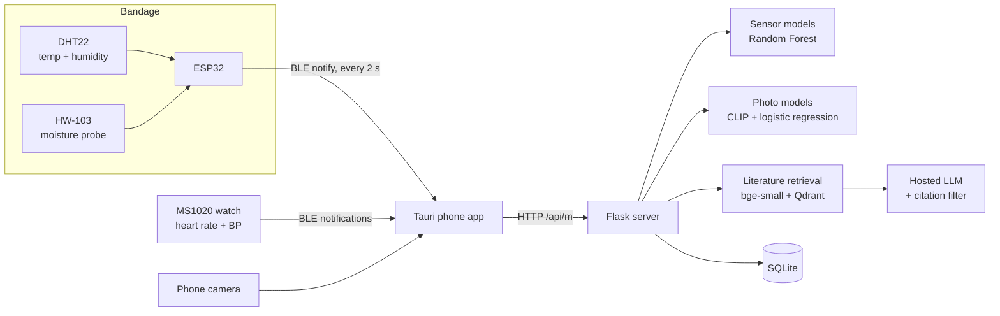

1. The ESP32 sends `temperature,humidity,moisture` over Bluetooth Low Energy every 2 seconds.
2. The app displays the values live and uploads a reading to the server every 15 seconds.
3. The server predicts a wound condition and an estimated time to heal, and stores the reading.
4. Photos are checked for quality, embedded with CLIP and classified for wound type and severity.
5. The chat retrieves the three most relevant papers from a 20-paper library, adds the patient's
   current readings to the prompt, and removes any citation that was not actually retrieved.

---

## Phone app

Built with **Tauri v2** (Rust shell, Android WebView, vanilla JavaScript). Sign in, see live
stats in the style of a health app, tap any metric for its history chart, scan a wound photo,
chat with the assistant, and connect the bandage and the watch.

### Getting started and home

<table>
<tr>
<td align="center"><br><sub>Sign in</sub></td>
<td align="center"><br><sub>Create account</sub></td>
<td align="center"><br><sub>Home: status, live tiles, tip of the day</sub></td>
</tr>
</table>

### Trends and metric history

Every tile opens a scrubbable chart. Temperature, humidity, moisture, heart rate, blood
pressure and estimated days to heal each have their own page.

<table>
<tr>
<td align="center"><br><sub>Trends (24 h / 7 d / 30 d)</sub></td>
<td align="center"><br><sub>Temperature</sub></td>
<td align="center"><br><sub>Humidity</sub></td>
</tr>
<tr>
<td align="center"><br><sub>Moisture</sub></td>
<td align="center"><br><sub>Heart rate (watch)</sub></td>
<td align="center"><br><sub>Blood pressure (watch)</sub></td>
</tr>
<tr>
<td align="center"><br><sub>Estimated days to heal</sub></td>
<td></td>
<td></td>
</tr>
</table>

### Wound scan

The centre button sends a photo to the server. It is checked for size, brightness and blur,
then classified for wound type and severity. Photos that look unlike the training data are
rejected with a friendly "retake" message instead of a guess.

<table>
<tr>
<td align="center"><br><sub>Scan screen</sub></td>
<td align="center"><br><sub>Scan result</sub></td>
<td></td>
</tr>
</table>

### My wound

<table>
<tr>
<td align="center"><br><sub>Overview: care tips with citations</sub></td>
<td align="center"><br><sub>Details form</sub></td>
<td align="center"><br><sub>Learn: sensor guides and research library</sub></td>
</tr>
</table>

### Ask AI, devices and profile

The chat history lives only in the app session. It is never stored on the server.

<table>
<tr>
<td align="center"><br><sub>Ask AI</sub></td>
<td align="center"><br><sub>Reply with citations</sub></td>
<td align="center"><br><sub>Connect bandage and watch</sub></td>
</tr>
<tr>
<td align="center"><br><sub>Profile and server address</sub></td>
<td></td>
<td></td>
</tr>
</table>

---

## Hardware

| Part | Role | Connection |
|---|---|---|
| ESP32 DevKit | Reads the sensors, advertises over BLE as `WoundSense-ESP32` | USB power |
| DHT22 | Temperature and relative humidity | VCC to 3V3, DATA to **GPIO 4**, GND to GND |
| HW-103 resistive moisture probe | Moisture at the dressing | VCC to 3V3, AO to **GPIO 34** (ADC1), GND to GND |
| MS1020 smartwatch | Heart rate and blood pressure, worn near the wound | BLE, read by the phone |

<p align="center">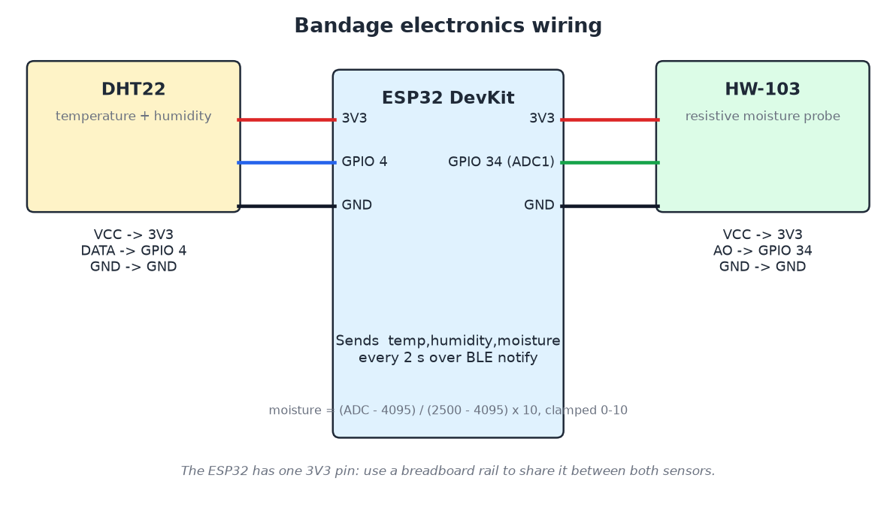</p>

- **Firmware:** [`esp32-test/firmware/woundsense_ble/woundsense_ble.ino`](esp32-test/firmware/woundsense_ble/woundsense_ble.ino)
  (Arduino IDE, board "ESP32 Dev Module", libraries "DHT sensor library" and "Adafruit Unified Sensor").
- **BLE contract:** service `4fafc201-1fb5-459e-8fcc-c5c9c331914b`, characteristic
  `beb5483e-36e1-4688-b7f5-ea07361b26a8`, notification text `temp,humidity,moisture`.
- **Moisture scaling:** `(raw - ADC_DRY) / (ADC_WET - ADC_DRY) * 10`, clamped to 0-10. The probe
  was calibrated from the serial monitor: about **4095 dry** and about **2440-2500 wet**.
  Re-measure if you change the probe or how deep it sits.
- **One 3V3 pin:** the ESP32 has a single 3V3 pin, so use a breadboard power rail to feed both sensors.
- **Watch:** the MS1020 sends notifications on characteristic `0xCC04`. A packet starting `0x20`
  carries heart rate in byte 10, and one starting `0xF3` carries systolic and diastolic pressure
  in bytes 2 and 3. The layout was decoded from observed traffic. The app never writes to the
  watch's firmware-update characteristic.
- **Single connection:** the phone's BLE plugin holds one connection at a time, so the app releases
  the bandage, measures on the watch, then reconnects the bandage.

<p align="center">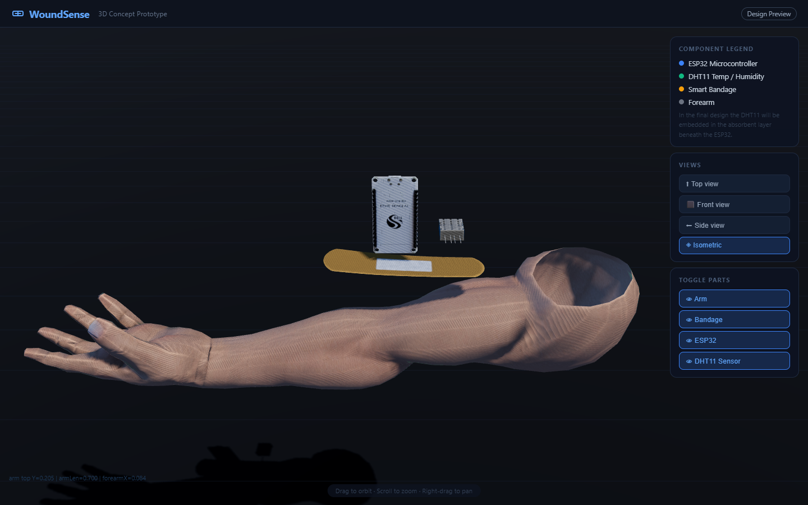<br><sub>Interactive 3D concept view of the bandage (ESP32 and sensor over the dressing) from the web dashboard</sub></p>

---

## Machine-learning models

Only four small models are trained in this project. The rest is pretrained and used as it is.

| Model | What it does | How it was built |
|---|---|---|
| Sensor **condition** classifier | healthy, wound healing or infected from temperature, humidity and moisture | Random Forest, 300 trees, depth 10 |
| Sensor **healing-time** regressor | estimated days to heal | Random Forest regressor, same inputs |
| Photo **wound-type** head | 10 wound types from a photo | Frozen CLIP ViT-B/32 embeddings + logistic regression |
| Photo **severity** head | mild, moderate or severe | Same embeddings + logistic regression |
| Literature retrieval | finds relevant papers for a question | Pretrained `bge-small-en-v1.5` embeddings in Qdrant (no training) |
| Chat | writes the answer from retrieved papers and current readings | Hosted LLM (default `openai/gpt-oss-120b` on Groq), not trained here |

### Sensor models

Trained in [`models/train_mobile_model.py`](models/train_mobile_model.py) on 20,000 rows with an
80/20 stratified split.

<p align="center">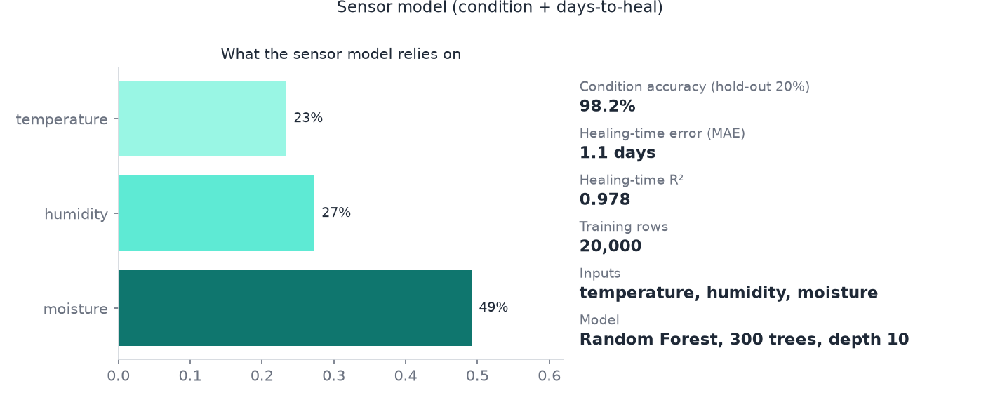</p>

### Wound-photo models

Trained in [`models/train_scan_model.py`](models/train_scan_model.py) on 1,564 images from the
[`rupeshsah/wound`](https://huggingface.co/datasets/rupeshsah/wound) dataset (Apache-2.0).

- Each photo becomes a 512-number embedding from a frozen CLIP encoder. Only a small linear
  classifier is trained on top, which is quick and needs no GPU.
- The collection contains many near-copies of the same photo (651 pairs with cosine similarity of at least 0.97).
  They are grouped so that copies never sit on both sides of a split. That leaves 937 independent groups,
  evaluated with 5-fold grouped cross-validation.
- Result on photos the model had not seen: **77.6% accuracy** and **0.80 macro-F1** for wound type
  (always guessing the biggest class would score 21%). Severity scores 0.77 macro-F1 against 0.62 for
  a baseline that already knows the true wound type, so it is kept.
- A photo whose nearest neighbour in the training set falls below a similarity of 0.874
  (the 5th percentile of held-out photos) is treated as unlike the training data and not classified.

<table>
<tr>
<td align="center">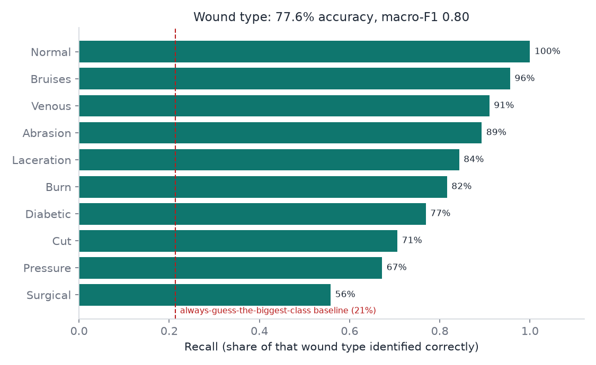<br><sub>Recall per wound type</sub></td>
<td align="center">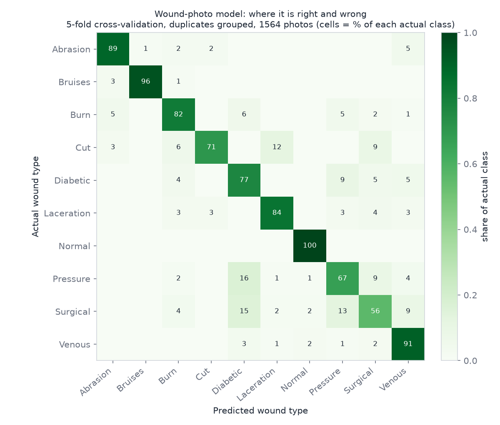<br><sub>Confusion matrix (% of each actual class)</sub></td>
</tr>
</table>

These charts are generated from the numbers the training script saved in
[`models/scan/metadata.json`](models/scan/metadata.json).

### Original web-dashboard models

The website uses a separate five-input version (pH, temperature, humidity, exudate, oxygen),
trained with [`models/train_model.py`](models/train_model.py). Its comparison charts:

<table>
<tr>
<td align="center">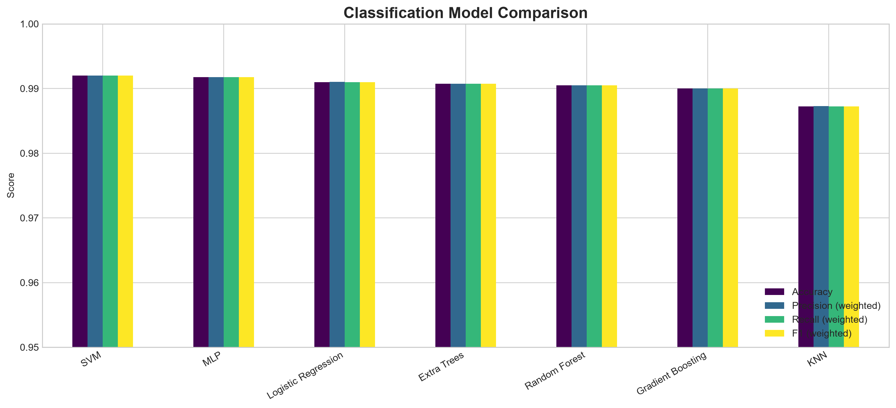<br><sub>Classifier comparison</sub></td>
<td align="center">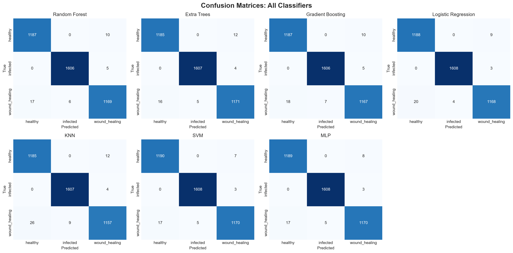<br><sub>Confusion matrices</sub></td>
<td align="center">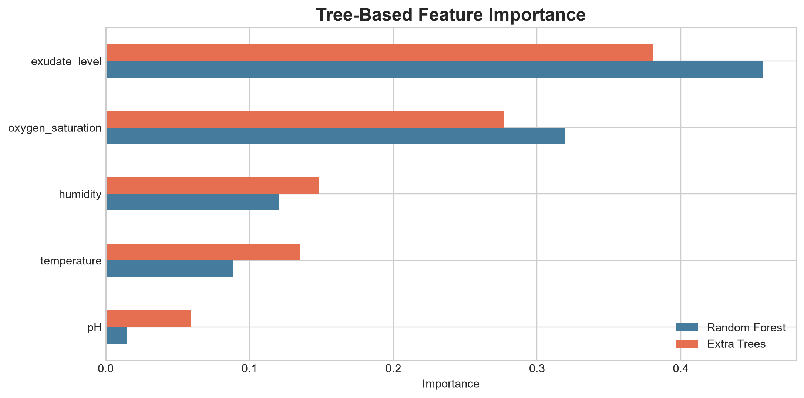<br><sub>Feature importance</sub></td>
</tr>
</table>

### Grounded chat

The assistant is given the patient's readings, the latest scan, the retrieved papers and a list of
allowed citation tags. A streaming filter drops any `[Author, year]` that was not in that list, so it
cannot cite a study that was not retrieved. The 20 papers in
[`data/literature_verified.json`](data/literature_verified.json) had their titles, authors,
journals, DOIs and PubMed IDs checked against NCBI.

---

## Web dashboard

The original Flask site: sign-up and login, a five-slider dashboard that runs the model live,
a patient chat, wound details, model insights, an interactive knowledge graph of 20 papers,
5 sensors, 7 clinical states and 6 interventions, and a 3D concept view.

<table>
<tr>
<td align="center">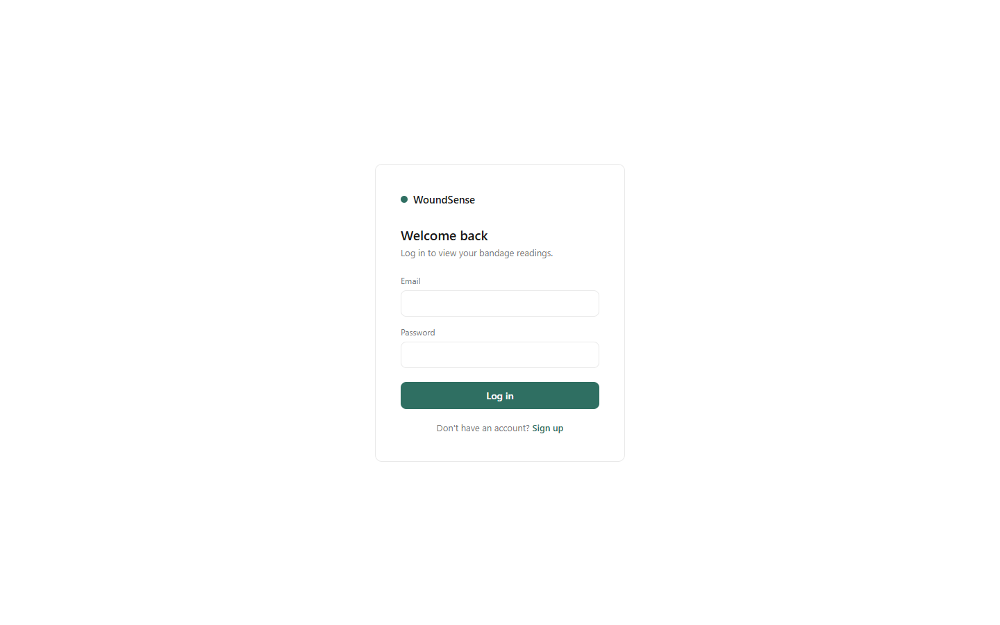<br><sub>Login</sub></td>
<td align="center">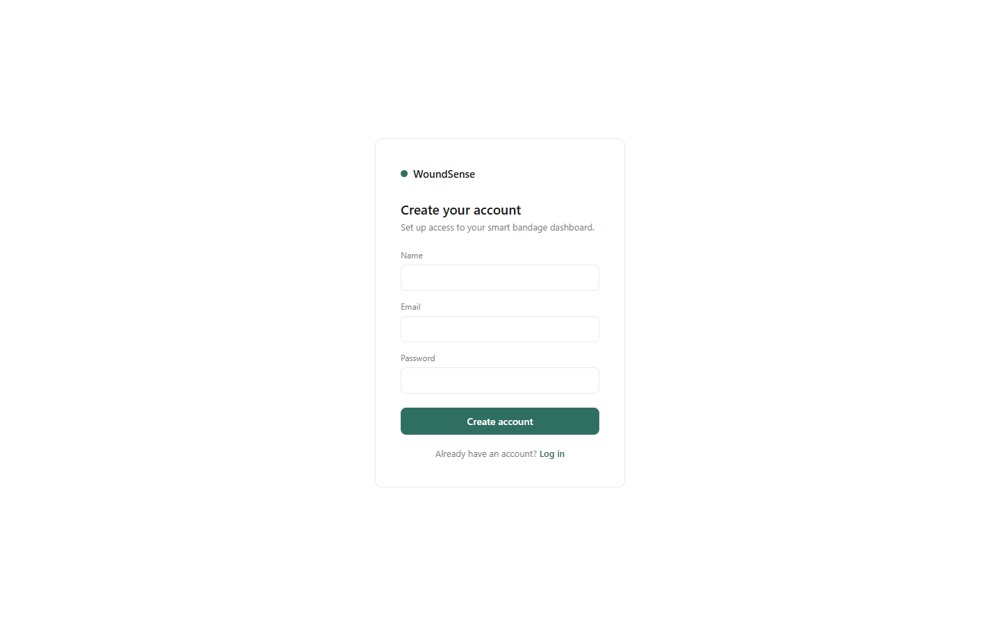<br><sub>Sign up</sub></td>
</tr>
<tr>
<td align="center">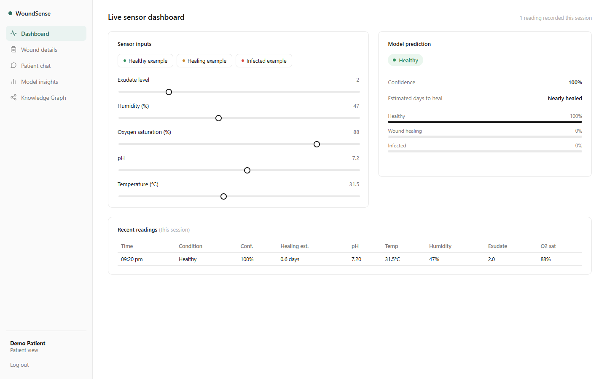<br><sub>Live sensor dashboard</sub></td>
<td align="center">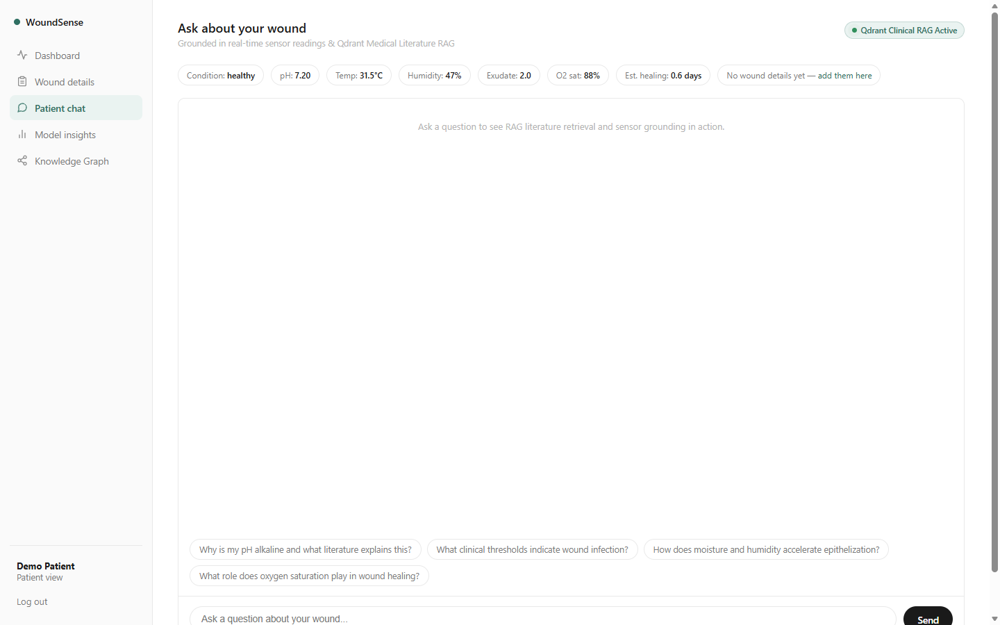<br><sub>Patient chat</sub></td>
</tr>
<tr>
<td align="center">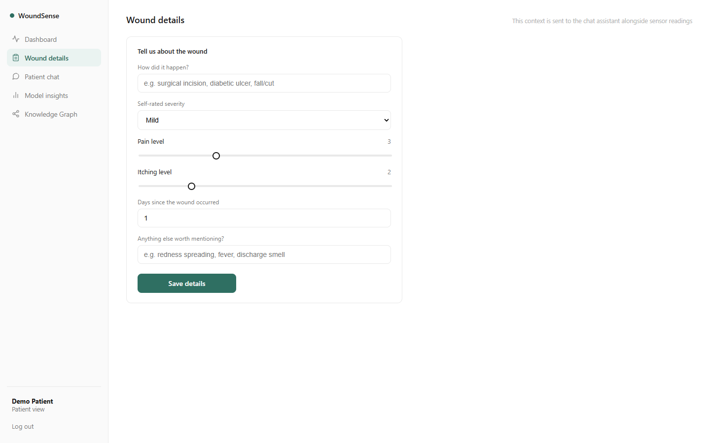<br><sub>Wound details</sub></td>
<td align="center">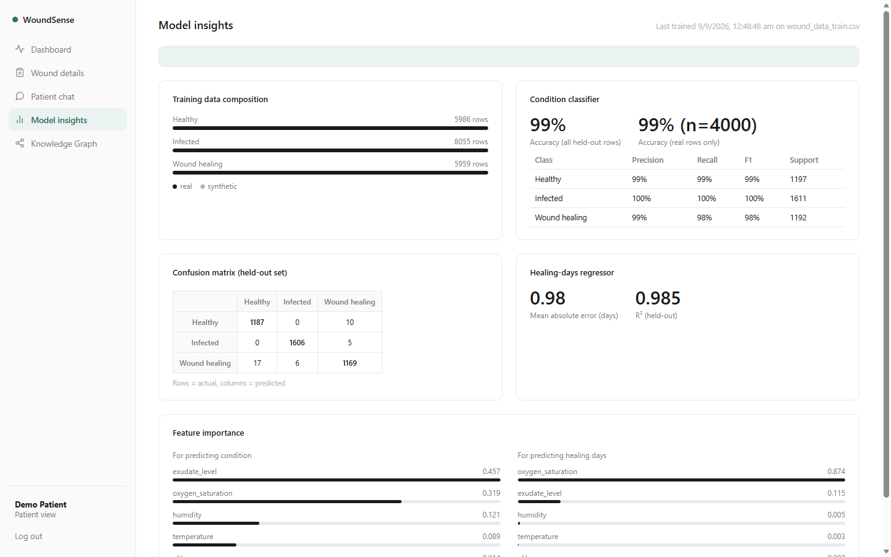<br><sub>Model insights</sub></td>
</tr>
<tr>
<td align="center">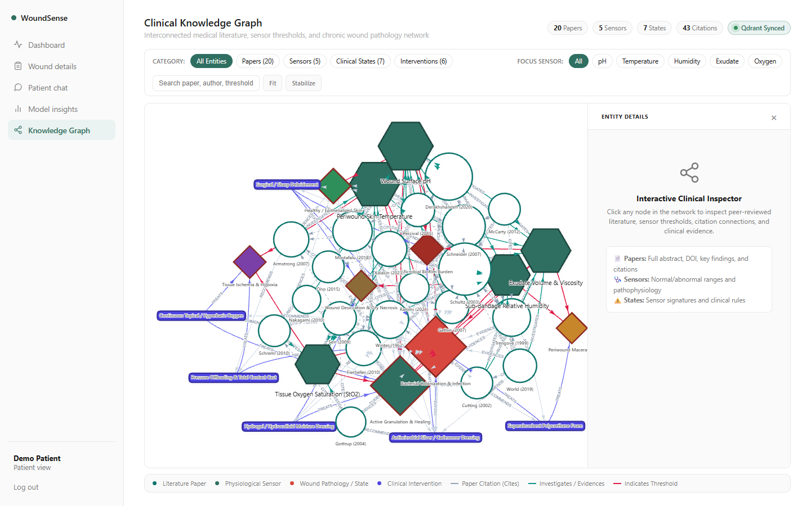<br><sub>Clinical knowledge graph</sub></td>
<td align="center"><br><sub>3D concept view</sub></td>
</tr>
</table>

---

## Run it

### 1. Server (website and phone API)

```bash
python -m venv venv
venv\Scripts\activate            # macOS/Linux: source venv/bin/activate
pip install -r requirements.txt
cp .env.example .env             # then set GROQ_API_KEY (chat works without it, but says the key is missing)

python app.py                    # website only, http://127.0.0.1:5000
python mobile_server.py          # website + /api/m phone API, listens on 0.0.0.0:5000
```

The trained models are committed under `models/`. To retrain:

```bash
python models/train_mobile_model.py      # seconds
python models/train_scan_model.py        # minutes on first run; needs the dataset in data/images/
```

### 2. ESP32

Open the `.ino` file in the Arduino IDE, wire the sensors as above, calibrate `ADC_DRY` and
`ADC_WET` for your probe, and upload. The serial monitor prints the raw moisture value and the payload.

### 3. Phone app

Requires Node, Rust with the Android targets, Android Studio (SDK and NDK) and a phone with USB or wireless debugging.

```bash
cd esp32-test/app
npm install
npm run tauri android dev -- --host <your-PC-IP>     # live, while the PC is reachable
npm run tauri android build -- --debug --apk         # standalone APK
```

In the app, enter `http://<PC-IP>:5000` as the server address. More detail is in
[`esp32-test/README.md`](esp32-test/README.md).

---

## Repository layout

```
app.py, database.py, rag_service.py     Flask website, SQLite helpers, retrieval service
mobile_api.py, mobile_server.py         /api/m/* phone API mounted on the same Flask app
models/                                 training scripts and trained models
  train_model.py                        website model (5 inputs)
  train_mobile_model.py -> mobile/      phone sensor model (3 inputs)
  train_scan_model.py   -> scan/        wound-photo models + metadata.json
data/                                   training CSVs, verified literature, embeddings
esp32-test/firmware/                    ESP32 sketch
esp32-test/app/                         Tauri phone app (src/ = JavaScript UI, src-tauri/ = Rust + Android)
templates/, static/                     website pages, styles, scripts
report_screenshots/                     phone-app screenshots
docs/                                   wiring diagram, model charts, web screenshots
tests/                                  retrieval and knowledge-graph tests
```

---

## Honest scope

- **No public dataset links these sensors to healing outcomes**, so the sensor models cannot be
  clinically validated. They were trained on a 20,000-row file of augmented/synthetic sensor data.
  Its 98% hold-out accuracy shows that the pipeline works end to end, not that it would be that accurate on patients.
- **Days to heal** comes from a severity heuristic, not from measured recoveries.
- **Moisture** from the resistive probe is mapped onto the dataset's 0-10 exudate scale by assumption.
- **The photo models** match the labels of a web-collected image set. Wound-type labels come from the
  collection, and the severity labels look machine-generated. There are no infection or healing-time
  labels in that data, so the photo models predict neither. It is cross-validated, not clinically validated.
- **Heart rate and blood pressure** are shown and passed to the chat as context. They do not feed the models.
  The watch's readings are consumer-grade.
- **Demo data** is stored with `source = "demo"` and never mixed with real readings.
- The website's original paper list in `data/literature_data.py` has wrong PubMed IDs for many entries.
  The phone app and chat use the verified set in `data/literature_verified.json`.
- The 3D concept view labels the temperature sensor "DHT11"; the hardware used is a DHT22.

With real labelled data (sensor readings matched to clinician assessments and measured wound sizes),
the same code could be retrained and properly validated.

## Credits

Wound photos: [`rupeshsah/wound`](https://huggingface.co/datasets/rupeshsah/wound) (Apache-2.0).
Image embeddings: CLIP ViT-B/32 via [fastembed](https://github.com/qdrant/fastembed). Text embeddings:
`BAAI/bge-small-en-v1.5`. Vector store: [Qdrant](https://qdrant.tech). Phone app: [Tauri](https://tauri.app)
with [`tauri-plugin-blec`](https://crates.io/crates/tauri-plugin-blec).
